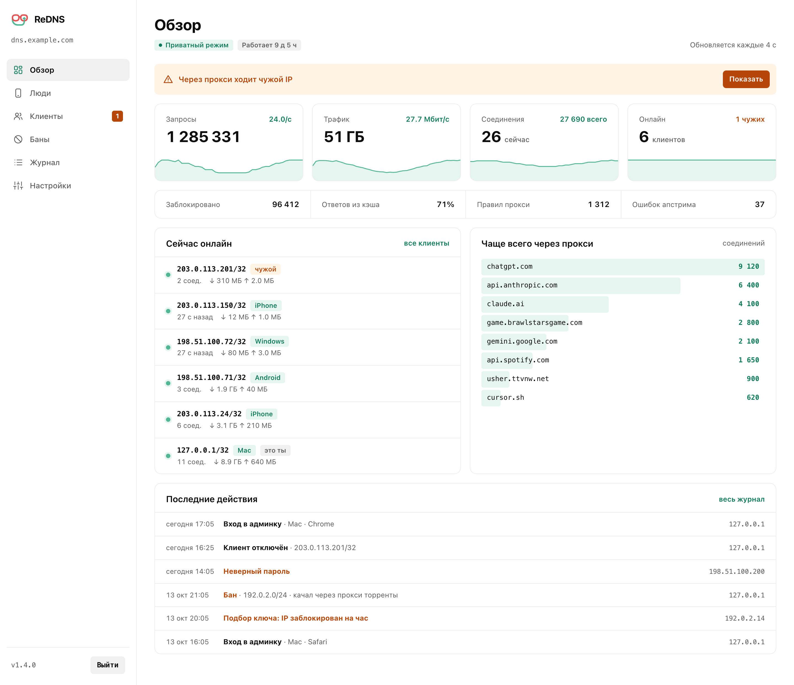
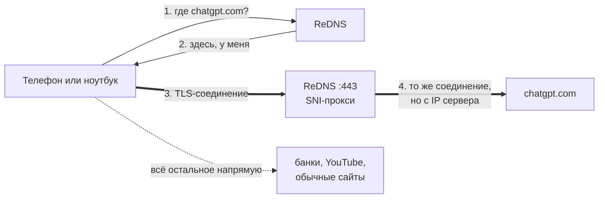
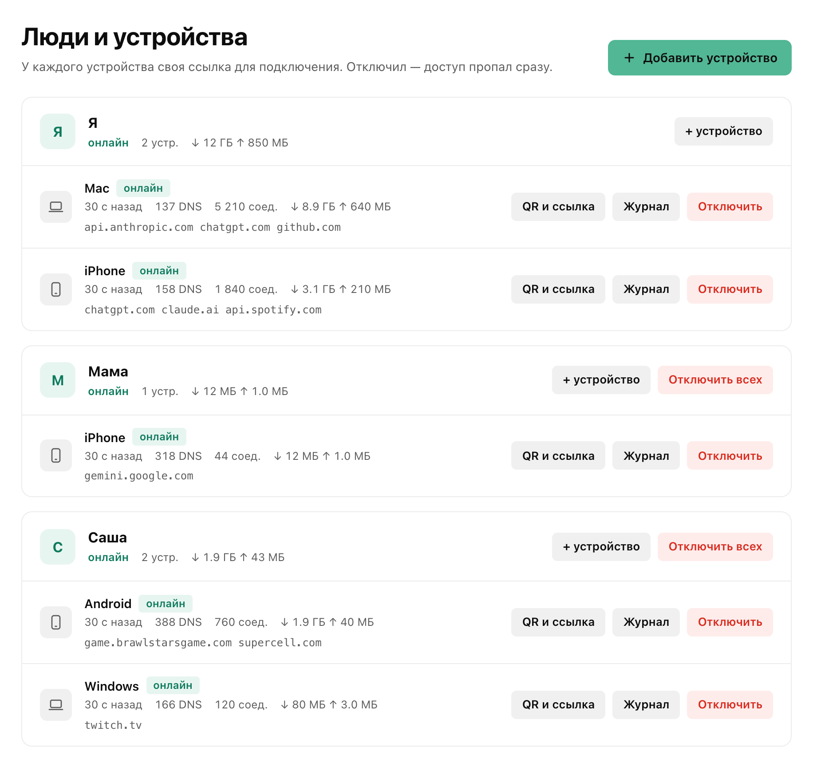
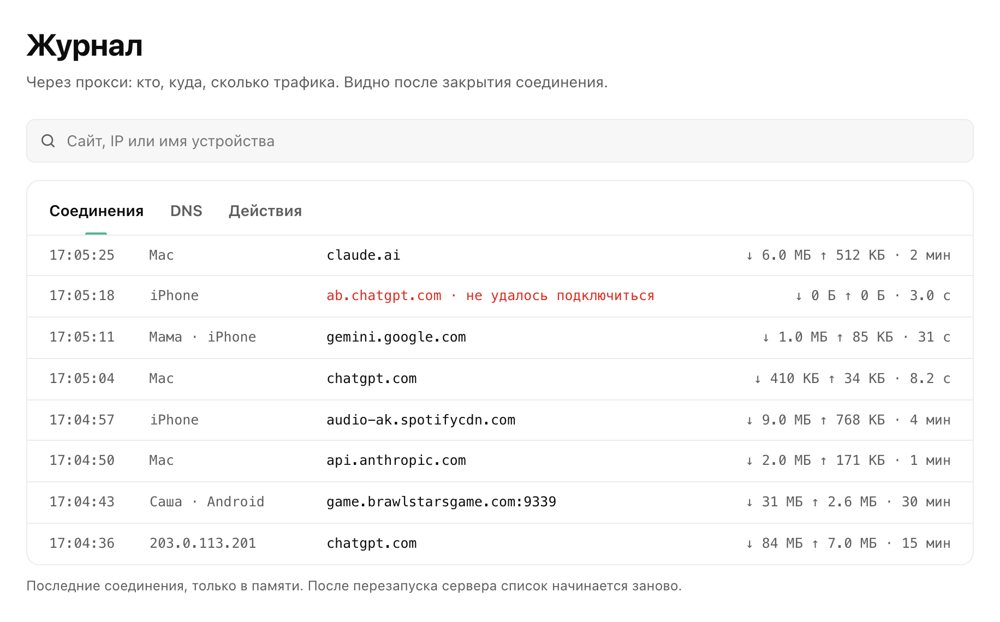

<div align="center">


# ReDNS

**ChatGPT, Claude, Gemini, Brawl Stars и Spotify из России без VPN.**<br>
Свой умный DNS, как Comss DNS, только на твоём сервере и только для твоих людей.

[](https://github.com/renothingg/redns/actions/workflows/ci.yml)
[](go.mod)
[](LICENSE)
[](#установка)

[Как это работает](#как-это-работает) ·
[Установка](#установка) ·
[Устройства](#подключение-устройств) ·
[Админка](#админка) ·
[Безопасность](#безопасность-и-приватность) ·
[Вопросы](#частые-вопросы)

<br>

<picture>
  <source media="(prefers-color-scheme: dark)" srcset="docs/admin-dark.png">
  
</picture>

</div>

## Зачем

ChatGPT, Claude, Gemini и ещё сотни сервисов сами не пускают пользователей из России. Это не РКН, это блокировка на их стороне по IP. Чтобы её обойти, не надо гнать весь трафик через VPN. Достаточно, чтобы именно к этим сервисам соединение приходило с зарубежного адреса.

Публичные DNS вроде Comss так и работают, но они общие: в часы пик тормозят, иногда лежат, и непонятно, кто ещё сидит на том же IP. ReDNS делает то же самое на твоём VPS за 3–5 € в месяц.

|                                  | VPN                 | Comss, malw.link       | **ReDNS**              |
| -------------------------------- | ------------------- | ---------------------- | ---------------------- |
| Весь трафик идёт через сервер    | да                  | нет                    | нет                    |
| Банки, Госуслуги, местные сайты  | часто ломаются      | работают               | работают               |
| Скорость                         | как повезёт         | общий сервер           | только твои устройства |
| Батарея телефона                 | садится             | не тратится            | не тратится            |
| Кто видит твои DNS-запросы       | VPN-провайдер       | чужой сервер           | только ты              |
| YouTube, Instagram, Discord      | да                  | нет                    | нет                    |

Последняя строка честная: то, что режет РКН через DPI, DNS не спасёт. Для этого нужен VPN.

## Что разблокирует

| | |
| --- | --- |
| **Нейросети** | ChatGPT и Codex, Claude и Claude Code, Gemini и AI Studio, Grok, Copilot, Perplexity, Midjourney, Suno |
| **Редакторы и агенты** | Cursor, Windsurf, Zed, Warp, JetBrains AI, Replit, Lovable, v0, OpenRouter |
| **Игры** | Brawl Stars, Clash Royale, Clash of Clans, Squad Busters, Hay Day, mo.co, Marvel Snap, Xbox, GeForce NOW |
| **Музыка и видео** | Spotify, Twitch, Tidal, Deezer, SoundCloud |
| **Работа** | Notion, Figma, Canva, Miro, Linear, ClickUp, DeepL, Atlassian, JetBrains |

Полные списки лежат в [`lists/`](lists). Свои домены добавляются одной строкой, см. [настройку](#настройка).

## Как это работает



1. На запрос домена из списков DNS отвечает адресом твоего сервера. Остальные домены резолвятся как обычно, через Google DNS с ECS, чтобы CDN отдавали ближайшие к тебе узлы.
2. Устройство открывает TLS-соединение к серверу. Сервер читает имя сайта из ClientHello (SNI) и пробрасывает соединение дальше как есть.
3. Трафик не расшифровывается, сертификаты остаются настоящими. Сервис видит IP сервера, а не твой.

Игры Supercell ходят не по TLS, а по своему протоколу на порту 9339. Их сервер различает по последнему DNS-запросу клиента, поэтому хватает одного IP.

## Установка

Понадобится:

- **VPS** с Ubuntu 22.04+ или Debian 12+, хватит 1 CPU и 1 ГБ RAM. Лучше Европа: Швеция, Нидерланды, Германия, Финляндия. С США задержка заметно выше.
- **Домен** по желанию. Без него сервер возьмёт имя вида `1-2-3-4.sslip.io`. С доменом создай A-запись `dns` на IP сервера, в Cloudflare с режимом DNS only, без оранжевого облака.
- **Go 1.26+** на компьютере, с которого ставишь.

Дальше одна команда с компьютера:

```bash
./deploy/deploy.sh root@IP --domain dns.example.com --secure-ssh
```

Скрипт соберёт бинарник, зальёт его, поставит сервис, получит сертификат Let's Encrypt и в конце покажет три вещи: ссылку настройки для первого устройства, адрес админки и пароль от неё.

`--secure-ssh` закрывает вход на сервер по паролю. Скрипт создаст SSH-ключ на компьютере, если его нет, положит на сервер, проверит, что по ключу пускает, и только потом отключит пароли.

Повторный запуск той же команды обновляет сервер. Конфиг, устройства, баны и журнал при этом остаются.

<details>
<summary>Установка прямо на сервере, без компьютера</summary>

```bash
git clone https://github.com/renothingg/redns && cd redns
sudo ./deploy/install.sh --domain dns.example.com
```

Нужен Go на сервере, установщик соберёт всё из исходников.
</details>

> [!WARNING]
> ТСПУ часто режет соединения к крупным хостерам (Hetzner, DigitalOcean, OVH): загрузка замирает после ~16 КБ. После установки нажми «Проверить» на странице настройки. Если полоска встала, лучше сразу взять другого хостера.

## Подключение устройств

У каждого устройства свой ключ и своя ссылка вида `https://dns.example.com/setup/<ключ>`. Ссылки выдаются в админке, там же QR-код и кнопка «Поделиться». На странице по ссылке есть инструкция для каждой системы, а сверху видно, доходят ли запросы.

| Устройство | Как подключить |
| --- | --- |
| iPhone, iPad, Mac | Скачать профиль со страницы и установить в настройках. Ключ уже внутри. |
| Apple Watch | Профиль не ставится, в watchOS нет настроек DNS. Рядом с iPhone часы идут через него, по Wi‑Fi используют DNS роутера, по LTE обойти DNS оператора нельзя. |
| Android | Встроенный «Частный DNS»: имя хоста вида `ключ.dns.example.com` со страницы настройки. Нужен токен Cloudflare на сервере, см. ниже. Без него — приложение Intra или RethinkDNS с адресом DoH. |
| Windows 11 | Параметры → Сеть → DNS → «DNS через HTTPS» с шаблоном со страницы. |
| Браузер | Chrome, Edge, Яндекс, Firefox: «Безопасный DNS» → свой адрес. |
| Роутер | Keenetic и MikroTik умеют DoH, инструкция на странице. |

<details>
<summary>«Частный DNS» на Android</summary>

Android умеет только DoT, и ключ туда можно передать лишь в имени сервера: `ключ.dns.example.com`. Чтобы такие имена не светились в публичных логах сертификатов, сервер получает один wildcard-сертификат на `*.dns.example.com`. Let's Encrypt выдаёт wildcard только через проверку по DNS, поэтому серверу нужен доступ к DNS домена. Пока это работает с Cloudflare.

1. Cloudflare → My Profile → API Tokens → Create Token → шаблон «Edit zone DNS».
2. Zone Resources: Include → Specific zone → твой домен. Create Token, скопируй токен.
3. На сервере выполни `sudo redns cloudflare` и вставь токен.

Сервер сам создаст запись `*.dns`, получит сертификат и будет продлевать его. Через пару минут на странице настройки во вкладке Android появится имя для «Частного DNS».

Ключ в имени сервера видит провайдер связи: имя передаётся открыто при подключении. Для iPhone, Mac и Windows профиль по-прежнему использует DoH, где ключ спрятан внутри шифрования.
</details>

Перед установкой удали старые DNS-профили, выключи VPN и Частный узел iCloud, иначе запросы пойдут мимо.

## Админка

`https://dns.example.com/admin`. Пароль показывает установщик, поменять его можно на сервере командой `sudo redns passwd`.

<table>
  <tr>
    <td width="50%"></td>
    <td width="50%"></td>
  </tr>
  <tr>
    <td><b>Люди.</b> Свои устройства и устройства друзей, сгруппированные по людям: кто онлайн, сколько трафика, куда ходит.</td>
    <td><b>Журнал.</b> Соединения через прокси, DNS-запросы и действия: кто, куда, сколько, когда.</td>
  </tr>
</table>

- **Люди.** Новое устройство добавляется в два нажатия: выбрал, чьё и что это (iPhone, Android, Mac…), получил ссылку и QR. Отключить можно одно устройство или сразу все устройства человека.
- **Клиенты.** Все IP, которые ходили в DNS или через прокси. Свои подписаны, чужие подсвечены. Любого можно отключить или забанить вместе с подсетью.
- **Журнал соединений.** Каждое соединение через прокси: устройство, сайт, трафик в обе стороны, длительность, ошибки подключения.
- **Журнал действий.** Входы в админку, неверные пароли, баны, новые и удалённые устройства, а ещё то, что сервер замечает сам: подбор ключей, перезапуски, смена пароля. Пишется в `audit.log`, переживает перезапуски.
- **Сессии.** Видно, где открыта админка: браузер, IP, когда заходили. Чужую сессию можно завершить, а можно выйти везде, кроме текущей.
- **Режим прокси.** «Для всех» или «только свои устройства».

Посторонним админка не видна: на `/admin` они получают 404, как будто её нет. Первый раз её открывают с устройства, подключённого к ReDNS, или после того как на нём открыли свою ссылку настройки. После входа браузер помнит тебя неделю с последнего визита, даже если сменился IP или включился VPN.

## Безопасность и приватность

В репозитории нет ни адресов, ни ключей. Домен, ключи устройств и пароль админки появляются при установке и лежат только на сервере: в `/etc/redns/config.yaml` и `/var/lib/redns/`. Кто склонирует код, получит свой сервер, а не доступ к твоему.

**Что видно снаружи:** домен и его IP (они есть в DNS и в логах сертификатов на crt.sh), и что на 443 порту отвечает веб-сервер.

**Что не видно без ключа:** DNS (на порт 53 тишина, DoH отвечает отказом), страница настройки (404) и админка (тоже 404).

<details>
<summary>Подробнее о защите</summary>

- Ключ из 20 случайных символов передаётся в пути DoH-запроса, внутри шифрования. Исключение — «Частный DNS» на Android: там ключ стоит в имени сервера, которое видно провайдеру. В логи сертификатов ключи не попадают: для них выпускается один wildcard-сертификат.
- После 10 неверных ключей за 10 минут IP блокируется на час, даже с правильным ключом.
- Админка: пароль в bcrypt; после 5 ошибок вход с IP закрыт на 15 минут. Cookie `HttpOnly`, `Secure`, `SameSite=Strict`, на диске хранятся только хэши сессий. Смена пароля завершает все сессии.
- Заголовки CSP без `unsafe-inline`, HSTS, `X-Frame-Options`, COOP, CORP.
- Лимит новых соединений к прокси: 100 в секунду с одного IP.
- Ответы апстрима проверяются: ID и вопрос должны совпадать с запросом.
- Сервис работает от отдельного пользователя в песочнице systemd: только `CAP_NET_BIND_SERVICE`, фильтр системных вызовов, файловая система только на чтение.
- Установщик включает фаервол (открыты только нужные порты, SSH с ограничением частоты), fail2ban и автоматические обновления безопасности.
- Журнал действий и файлы состояния доступны только пользователю `redns` (права `0600`).

</details>

> [!NOTE]
> В режиме прокси «для всех» тот, кто знает IP сервера, может прописать его в `hosts` для chatgpt.com и пользоваться прокси. Таких видно в админке как «чужих». Их можно забанить или включить режим «только свои устройства».

## Настройка

Конфиг лежит в `/etc/redns/config.yaml`, все параметры с пояснениями в [config.example.yaml](config.example.yaml). Списки доменов лежат в `/etc/redns/lists/`. Свои домены добавляй в `custom.txt`, установщик его не трогает:

```
example.com                     домен со всеми поддоменами
full:api.example.com            только этот хост
regexp:^ap-.*\.spotify\.com$    регулярка
```

Применить без перезапуска:

```bash
sudo systemctl reload redns
```

## Команды на сервере

| Команда | Что делает |
| --- | --- |
| `redns why chatgpt.com` | через что идёт домен: proxy, block или forward |
| `redns log -f` | DNS-запросы в реальном времени |
| `redns stats` | счётчики и топ доменов через прокси |
| `redns clients` | клиенты и их ключи |
| `redns lists` | загруженные списки |
| `sudo redns passwd` | новый пароль админки |
| `sudo redns key` | рабочая ссылка настройки; если твой ключ отключён, выдаст новый |
| `sudo redns cloudflare` | токен Cloudflare для «Частного DNS» на Android |
| `journalctl -u redns -f` | логи сервиса |

## Порты

| Порт | Зачем |
| --- | --- |
| 53 UDP/TCP | DNS |
| 80 TCP | HTTP-прокси и выпуск сертификата |
| 443 TCP | SNI-прокси, DoH, страница настройки, админка |
| 853 TCP/UDP | DoT и DoQ; в приватном режиме DoT для «Частного DNS» на Android |
| 9339, 30000, 4070 TCP | Supercell, mo.co, Spotify |

## Частые вопросы

<details>
<summary><b>/admin отдаёт 404</b></summary>

Так задумано: админку видят только твои устройства. Скорее всего, ты зашёл через VPN или с устройства, где ReDNS не включён. Открой на этом устройстве свою ссылку настройки, после этого `/admin` откроется. Войдёшь один раз, и браузер будет помнить тебя неделю, даже через VPN.

Если 404 отдаёт и сама ссылка настройки, значит, ключ из неё отключён. Выполни на сервере `sudo redns key`: команда покажет рабочую ссылку или выдаст новый ключ.
</details>

<details>
<summary><b>ChatGPT на iPhone ругается на сертификат</b></summary>

Так бывает, если включён режим «только свои устройства», а телефон сменил сеть (Wi-Fi ↔ LTE): новый IP сервер ещё не знает. Подожди минуту или верни режим «для всех».
</details>

<details>
<summary><b>Не заходит в Brawl Stars</b></summary>

Проверь, что на сервере открыт порт 9339 (установщик открывает его сам) и что на телефоне нет VPN. Закрой игру полностью и открой снова: ей нужен свежий DNS-запрос.
</details>

<details>
<summary><b>Почему не работает YouTube или Instagram</b></summary>

Их блокирует РКН через DPI у провайдера. DNS тут не поможет, нужен VPN. ReDNS обходит только блокировки со стороны самих сервисов.
</details>

<details>
<summary><b>Можно дать друзьям?</b></summary>

Да. В админке «Люди» → «Добавить» → «Другого человека». У него будут свои ключи, ты увидишь его трафик и сможешь отключить его в любой момент. Твои DNS-запросы он не видит.
</details>

<details>
<summary><b>Сколько это стоит</b></summary>

Только VPS: 3–5 € в месяц. Домен необязателен. Трафика нужно немного, потому что через сервер идут только нужные сервисы, а не всё подряд.
</details>